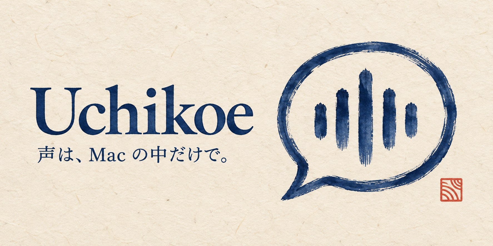

# Uchikoe

[ダウンロード](https://github.com/moguone/uchikoe/releases) · [コントリビュート](CONTRIBUTING.md)

**話した声を Mac の外に出さない、日本語の音声入力アプリ。**

キーを押して話すと、macOS の音声認識で文字にして、前面のアプリに貼り付けます。音声も文字にした結果も、Mac の外には送りません。メニューバーに常駐して使います。



## できること

- **押して話すだけ**: 既定は fn キー。押している間だけ録音するか、押すたびに録音を始める・止めるかを選べます。キーは変えられます。
- **Mac の中だけで完結**: 文字にするのも整えるのも Mac の中だけで行い、外部のサーバーは使いません。
- **フィラーを消す**: 「えー」「あの」などを取り除きます。
- **英単語を正しく書く**: 語彙リストに「GitHub = ギットハブ」のように読みを登録しておくと、カタカナで書かれた語を正しい綴りに直します。エンジニア向けとビジネス向けのリストが入っています。
- **清書**: Apple Intelligence がオンなら、英単語と句読点も整えます。

## 必要なもの

- Apple シリコンの Mac、macOS 26 以降
- 清書を使う場合は Apple Intelligence（オフでも、そのほかの機能は使えます）

## インストール

1. [Releases](https://github.com/moguone/uchikoe/releases) から zip をダウンロードして展開し、**Uchikoe.app をアプリケーションフォルダに移してから**開きます。
2. マイクとアクセシビリティの許可を求められるので、許可します。アクセシビリティは、キーの入力を受け取ることと、文字を貼り付けることに使います。
3. fn キーを使う場合は、システム設定 › キーボードの「🌐 キーを押して」を「何もしない」にします。

## 使い方

1. 文字を入れたい場所にカーソルを置きます。
2. fn キーを押している間に話し、離します。
3. 文字にした結果が貼り付けられます。

メニューバーのアイコンは、録音中は赤、文字にしている間は点 3 つになります。パスワード欄など、入力が保護されている場所には貼り付けず、クリップボードにコピーだけします。

## 設定

メニューバーのアイコン › 設定… で開きます。

| 項目 | 内容 |
|---|---|
| キー | 1 つか 2 つのキーの組み合わせ。fn や右⌥ だけでもよい |
| 録音のしかた | 押している間だけ録音／押すたびに録音を開始・終了 |
| 清書 | Apple Intelligence で英単語と句読点を整える |
| 記録 | 文字にした結果の履歴と、話した音声を残す（既定はどちらもオフ） |
| アップデート | アップデートを自動で確認する |
| ログイン時に起動 | Mac にログインしたときに起動する |

### 語彙リスト

設定の「語彙」タブで、リストの追加やオン・オフ、語の登録ができます。最初は「開発」と「ビジネス」のリストが入っていて、どちらもオフです。

| 表記 | 読み | 動き |
|---|---|---|
| GitHub | ギットハブ, キットハブ | 読みのように書かれたら、表記に直す |
| Rust | （空） | 大文字・小文字の違いだけを直す（rust → Rust） |

うまく書けない語があったら、実際に書かれた形を読みとして登録するのが確実です。

## プライバシー

音声、文字にした結果、クリップボードの中身は Mac の外に送りません。ネットワークを使うのは次のときだけです。

| いつ | 何をするか |
|---|---|
| 初めて文字にするとき | macOS が日本語の音声認識のデータを Apple からダウンロードする |
| アップデートを確認するとき | GitHub の Releases に更新を問い合わせる（設定でオフにできる） |

清書には Apple Intelligence の Mac の中で動くモデルだけを使い、Apple のサーバーで動くモデルは使いません。語彙リストや、オンにした場合の履歴と録音は、`~/Library/Application Support/Uchikoe/` に保存します。

## ソースからビルドする

Xcode（Swift 6.2 以降）が必要です。

```sh
git clone https://github.com/moguone/uchikoe.git
cd uchikoe
scripts/package-app.sh
open dist/Uchikoe.app
```

開発の進め方は [CONTRIBUTING.md](CONTRIBUTING.md) にあります。

## ライセンス

[MIT License](LICENSE)。同梱しているライブラリのライセンスは [THIRD_PARTY_NOTICES.md](THIRD_PARTY_NOTICES.md) にあります。
