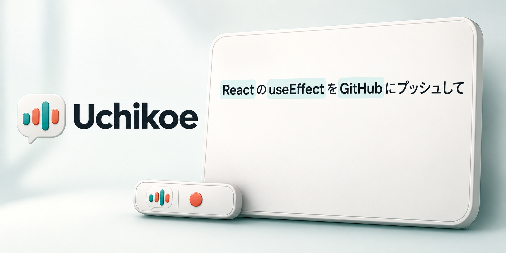

# Uchikoe

[ダウンロード](https://github.com/moguone/uchikoe/releases) · [コントリビュート](CONTRIBUTING.md)

**話した声を Mac の外に出さない、日本語の音声入力アプリ。**

キーを押して話すと、macOS に入っている音声認識で文字にして、前面のアプリに貼り付けます。音声も文字にした結果も、Mac の外には送りません。Apple シリコンの macOS 26 以降で動く、メニューバー常駐の小さなアプリです。



## できること

- **押して話すだけ**: 既定は fn キー。押している間だけ録音するか、押すたびに録音を始める・止めるかを選べます。キーは 1 つか 2 つの組み合わせに変えられます。
- **Mac の中だけで完結**: 文字にするのは macOS 内蔵の音声認識（SpeechAnalyzer）、整えるのは端末内の Apple Intelligence（Foundation Models）。サーバーも分析ツールもありません。
- **フィラーを消す**: 「えー」「あの」などを規則で取り除きます。「あの人」「まあいいか」のような言葉は残します。
- **英単語を正しく書く**: 語彙リストに「GitHub = ギットハブ」のように読みを登録しておくと、音声認識がカタカナで書いた語を正しい綴りに置き換えます。エンジニア向けの約 150 語と、ビジネス向けの略語のリストが入っています。
- **清書（任意）**: Apple Intelligence がオンなら、端末内のモデルで英単語と句読点を直します。翻訳や言い換えをしてしまった結果は使わず、規則で直した文に戻します。
- **元のクリップボードを戻す**: 貼り付けのあとに、元のクリップボードの中身を戻します。クリップボード管理アプリには、履歴に残さないよう頼む印（`org.nspasteboard.ConcealedType`）を付けます。

## 必要なもの

- Apple シリコンの Mac、macOS 26 以降
- 清書を使うなら Apple Intelligence をオンにする（オフでも、文字起こし・フィラーの除去・語彙の置き換えは動きます）

## インストール

1. [Releases](https://github.com/moguone/uchikoe/releases) から `Uchikoe-<バージョン>-macOS-arm64.zip` をダウンロードして展開し、**Uchikoe.app をアプリケーションフォルダに移してから**開きます。
2. マイクとアクセシビリティの許可を求められるので、許可します。アクセシビリティは、キー入力を見張ることと、⌘V を送って貼り付けることに使います。
3. fn キーを使う場合は、システム設定 › キーボードの「🌐 キーを押して」を「何もしない」にします。そうしないと、絵文字の入力などが一緒に動きます（設定画面にも注意が出ます）。

## 使い方

1. 文字を入れたいアプリ（エディタ、Slack、ブラウザなど）で、入力欄にカーソルを置きます。
2. fn キーを押している間に話し、離します。
3. 文字にした結果が貼り付けられます。メニューバーのアイコンが、録音中は赤、文字にしている間は点 3 つになります。

パスワード欄など、セキュア入力が有効な場所には貼り付けられません（macOS の仕様）。そのときは、結果をクリップボードに入れるだけにします。

## 設定

メニューバーのアイコン › 設定… で開きます。

| 項目 | 内容 |
|---|---|
| キー | 1 つか 2 つのキーの組み合わせ。fn や右⌥ のような修飾キー 1 つだけでもよい |
| 録音のしかた | 押している間だけ録音／押すたびに録音を開始・終了 |
| 清書 | Apple Intelligence で英単語と句読点を直す（Apple Intelligence がオンのときだけ） |
| 記録 | 文字にした結果と処理時間の履歴、話した音声の録音を残す（既定はどちらもオフ） |
| アップデート | アップデートを自動で確認するか |
| ログイン時に起動 | macOS のログイン項目に登録する |

### 語彙リスト

設定の「語彙」タブで、リストを増やしたり、リストごとにオン・オフしたりできます。1 行が 1 語で、「表記」と「読み」を書きます。

| 表記 | 読み | 動き |
|---|---|---|
| GitHub | ギットハブ, キットハブ, Gitハブ | 音声認識が読みのように書いたら、表記に置き換える |
| Rust | （空） | 大文字・小文字の違いだけを直す（rust → Rust） |

- 読みには、音声認識が実際に書いてきた形を入れるのが確実です。履歴を残す設定にすると、音声認識がそのまま書いた形（`raw`）を確認できます。
- カタカナの読みは、前後がカタカナのときは置き換えません（「リニア」で「リニアモーター」を変えない）。英数字の読みも、前後が英数字のときは置き換えません（「Go」で「Google」を変えない）。
- 最初は「開発」と「ビジネス」のリストが入っていて、どちらもオフです。

## プライバシー

音声、文字にした結果、クリップボードの中身は Mac の外に送りません。ネットワークを使うのは次のときだけです。

| いつ | 何を | どこへ |
|---|---|---|
| 初めて文字にするとき | 日本語の音声認識のデータのダウンロード | Apple（macOS が管理） |
| アップデートを確認するとき | 更新情報（appcast.xml）と、更新があればアプリの取得 | GitHub の Releases |

- 清書には、Apple Intelligence の端末内のモデル（`SystemLanguageModel`）だけを使います。Apple のサーバーで動くモデル（Private Cloud Compute）は使いません。
- アップデートの確認は、設定でオフにできます。更新を入れるときは確認を求め、署名を検証します（[Sparkle](https://sparkle-project.org/)）。
- 手元に残すのは次のものだけです。どれも `~/Library/Application Support/Uchikoe/` に置きます。
  - 語彙リスト（`vocabularies.json`）
  - 履歴（`history.jsonl`）と録音（`recordings/`）。設定でオンにしたときだけ

## ソースからビルドする

Xcode（Swift 6.2 以降）が必要です。

```sh
git clone https://github.com/moguone/uchikoe.git
cd uchikoe
scripts/test.sh            # 単体テスト
scripts/package-app.sh     # dist/Uchikoe.app を作る（アドホック署名）
open dist/Uchikoe.app
```

アドホック署名はビルドのたびに署名が変わるので、そのたびにマイクやアクセシビリティの許可を取り直すことになります。手元で使い続けるなら、自分の証明書で署名します。

```sh
CODE_SIGN_IDENTITY="Apple Development" scripts/package-app.sh
```

開発の進め方は [CONTRIBUTING.md](CONTRIBUTING.md)、リリースの手順は [docs/RELEASING.md](docs/RELEASING.md) にあります。

## ライセンス

[MIT License](LICENSE)。アプリの更新に使っている Sparkle のライセンスは [THIRD_PARTY_NOTICES.md](THIRD_PARTY_NOTICES.md) にあり、アプリにも同梱しています。

アプリのアイコンと紹介画像は、OpenAI の Codex の画像生成で作りました。メニューバーのアイコンはコード（`Sources/Uchikoe/StatusIcon.swift`）で描いています。
